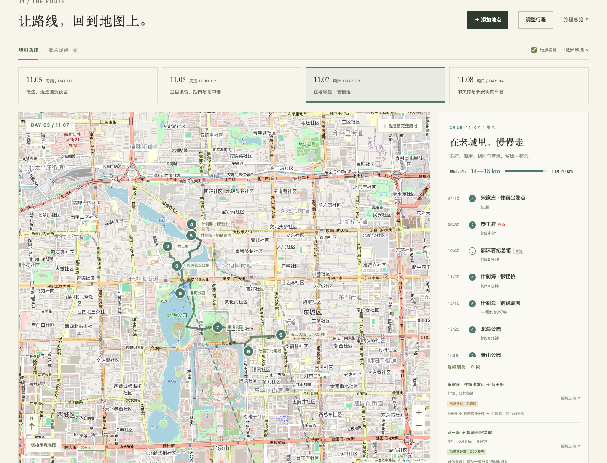
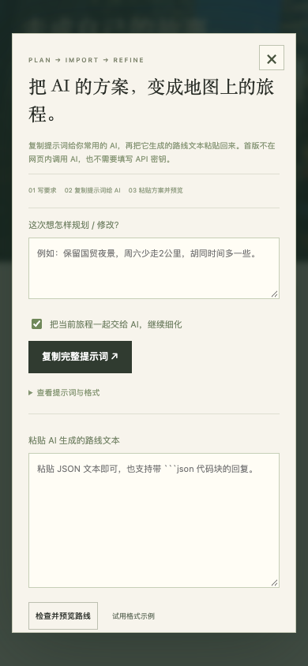

# 行间 · Journeys, Together

**简体中文** | [English](README.en.md)

> 用地图计划下一站，用照片记住每一程。

一个可自托管的轻量旅行规划与纪念网站。北京赏秋只是第一条示例；你可以新建杭州、东京或其他目的地的旅程，每条旅程独立保存路线、提醒与照片。

## 界面预览



地图数据 © OpenStreetMap contributors。北京是示例旅程；图片展示规划功能，不代表已完成的旅行。

<details>
<summary>查看手机上的 AI 路线导入</summary>



</details>

## 首版能做什么

- **旅程库**：新建旅程，设置日期、同行人数、住宿和每天步行上限，按天规划。
- **可调整地图**：地点名、北向、比例尺、按天路线、全程总览；可以搜索地点、地图选点、调整时间/顺序、略过可选站、编辑模式拖动图钉。
- **逐段路径**：每段分别设置交通方式、时间、距离、入口与换乘说明；可尝试在线步行/骑行/驾车算路、手绘转折点、导入 GeoJSON 路径。
- **AI 路线文本工作流**：填写需求 → 复制包含格式约束的提示词给常用 AI → 粘贴 JSON → 检查预览 → 新建旅程或更新当前旅程。支持常见 Markdown 代码块；更新前保留一份可撤销版本。
- **按地点归档照片**：上传、压缩、本地保存；切到「照片足迹」后，每个图钉对应一个地点相册。可以重新分配照片归属。
- **准备清单**：预约、天气、交通等自定义提醒；下载日历文件后导入自己的日历。
- **携带与分享**：路线分享链接、旅程文本/完整备份导入导出、公开相册数据导出。

## 先运行起来

无需安装运行依赖，用 Python 3 在项目根目录启动：

```sh
python3 -m http.server 4174 --directory dist
```

打开 `http://localhost:4174`。不要直接双击 HTML：相对数据文件需要 HTTP 服务。

## 用 AI 反复细化方案

1. 点击「AI 路线助手」，写清目的地、日期、想去/不想去的地方、体力和交通要求。
2. 保留「把当前旅程一起交给 AI」可继续优化已有方案；取消勾选可规划新旅程。
3. 复制完整提示词给常用 AI，要求输出 `xingjian/1` JSON。
4. 把结果粘贴到网站。先检查预览与警告，再选择作为新旅程或更新当前旅程。
5. 导入后逐日查看、定位不确定的地点，再为每段补上真实路径或交通说明。

首版**没有内置 GPT/API 调用**，不需要 API 密钥。提示词生成、文本导入和可视化在浏览器完成。格式见 [docs/route-format.md](docs/route-format.md)，示例见 [dist/data/ai-example.json](dist/data/ai-example.json)。

## 地图与路径的含义

| 显示 | 含义 |
| --- | --- |
| 实线、沿道路计算 | 在线道路算路服务返回的路径；仍是参考，不是实时导航 |
| 点线、手绘路径 | 用户在地图上画的参考路径 |
| 点线、导入路径 | 从 AI 文本或 GeoJSON 带入的路径，未自动核验 |
| 虚线、示意连线 | 仅连接地点，尚未取得道路路径，不能当实际路线 |
| 待定位 | 没有可信坐标，不会猜测位置或放到地图原点 |

在线底图使用 OpenStreetMap。北京示例附带本地地理示意图，其他城市网络不可用时显示坐标网格、地点与北向。图钉坐标使用 **WGS84**；不要将高德 GCJ-02、百度 BD-09 直接混入。

在线算路使用 FOSSGIS 的步行、骑行和驾车 OSRM 服务，每次由用户点击触发、最多每秒一次；端点坐标会发送到该服务。失败或超时不会伪造线路。**已在真实浏览器成功取得道路路径，并为北京示例保存可用的步行/骑行路径。** 公共服务仍可能在其他网络环境中超时；未取得的路段保留示意线。导入、手绘、路径保存和渲染已通过浏览器验证。公交/地铁不自动按步行道路计算，需填写实际换乘或导入线路。

路径可能不反映景区入口、营业、施工或临时管制；出行时用地点卡片打开高德或国际地图复核。

## 照片与多人分享

这是没有服务器数据库的静态首版，**没有云端实时协作**：

| 操作 | 数据去哪里 |
| --- | --- |
| 修改行程 | 当前浏览器的 localStorage，各旅程分开 |
| 上传照片 | 当前浏览器的 IndexedDB，按旅程和地点关联 |
| 分享旅程 | 链接携带路线与修改，不含本地照片 |
| 导出完整备份 | JSON 包含路线、修改和压缩照片，同行可导入 |
| 导出公开相册数据 | 将 `trip.json` 替换到 `dist/data/trip.json` 并重新部署后，所有访客可见 |

照片最长边缩放为1600像素，适合精选纪念照。清理浏览器数据、切换设备/域名或使用无痕模式会影响本地记录，记得导出备份。不要把敏感证件、票码或不想公开的照片提交到公开仓库。

AI 更新按地点 id 或名称匹配已有照片，保留有照片的旧地点；导入为新旅程则不改变原旅程。仅有照片但尚未关联地点时，可从相册重新选择归属。

## 项目结构与检查

```text
dist/
  index.html             页面、编辑与导入表单
  styles.css             桌面与手机样式
  app.js                 旅程库、地图、编辑器与相册交互
  route-core.js          路线格式解析、坐标与几何规则
  data/trip.json         默认示例旅程
  data/ai-example.json   可导入的格式演示
  assets/photos/         北京示例参考照片与许可清单
  assets/vendor/         本地 Leaflet 组件
scripts/
  test_core.cjs          纯逻辑测试，无需安装依赖
  check_project.py       示例数据、文件与许可校验
  browser_smoke.mjs      可选 Playwright 浏览器检查
docs/route-format.md     AI 导入格式说明
```

```sh
node scripts/test_core.cjs
node --check dist/app.js
python3 scripts/check_project.py
```

可选浏览器检查：安装开发依赖与 Playwright Chromium，先启动本地网站，再运行 `npm run test:browser`。测试对外部算路服务使用明确的模拟响应，用于核验界面、存储和路径渲染，不代表真实服务可用。

## 项目状态与贡献

当前为 **v0.1.0 基础原型**。已实现的功能与待完善方向分开记录，不把路线参考当作正式导航。欢迎通过 [Issues](https://github.com/hjskyline/xingjian/issues) 提出使用问题和改进建议；提交 PR 前，请运行上面的检查，并保留图片署名。

## 开源

代码使用 MIT。第三方照片和 Leaflet 各自保留原许可，见 [ATTRIBUTION.md](ATTRIBUTION.md)。北京参考照片不是实时叶色或灯光信息。后续计划见 [ROADMAP.md](ROADMAP.md)。
